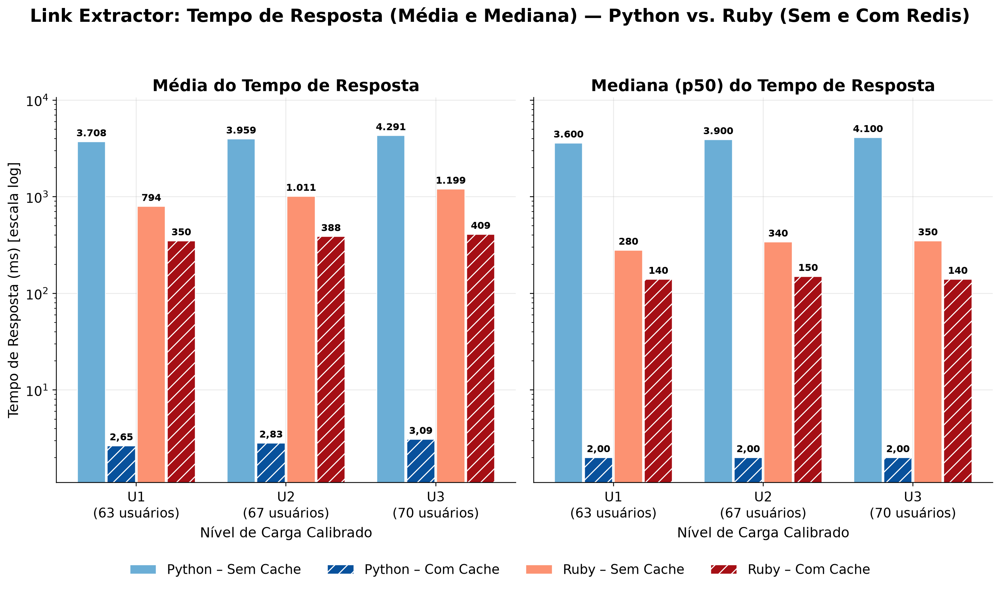
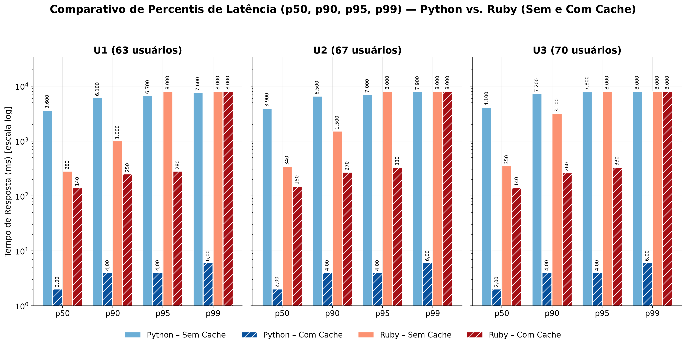
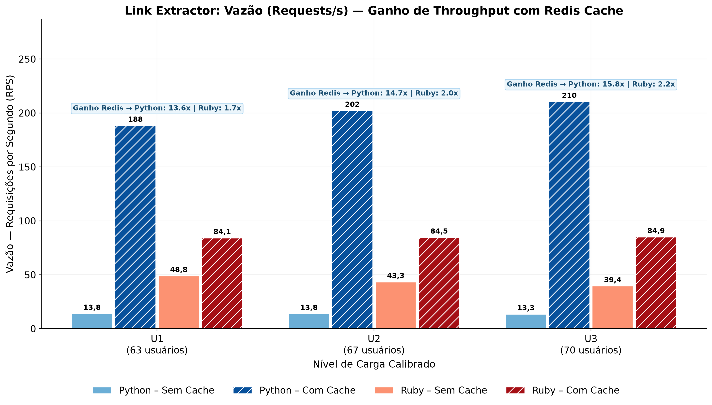
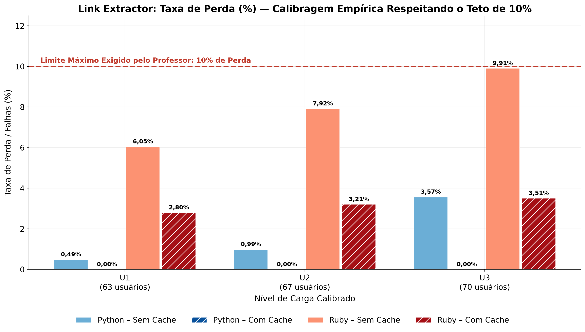

# Trabalho 4 – Realização de Testes de Desempenho com a Aplicação Link Extractor

Implementação completa de ponta a ponta dos testes de desempenho com **Locust** sobre a aplicação **Link Extractor** ([`ibnesayeed/linkextractor`](https://github.com/ibnesayeed/linkextractor), tutorial *Application Containerization and Microservice Orchestration* — etapas `step4`, `step5` e `step6`), composta por:

- Front-end web em **PHP 8.3 + Apache** ([`web/index.php`](web/index.php));
- Serviço de API de extração de links em **duas linguagens**: **Python (Flask + Gunicorn + BeautifulSoup/lxml)** e **Ruby (Sinatra + Puma + Nokogiri)**;
- Serviço de cache em memória **Redis 7** (`redis:7-alpine`).

Foram avaliados **12 cenários experimentais** (`2 Linguagens × 2 Modos de Cache × 3 Níveis de Carga [U1, U2, U3]`), com os níveis de usuários virtuais **`[U1 = 63, U2 = 67, U3 = 70]` calibrados empiricamente** respeitando rigorosamente o **limite máximo de 10% de perda** exigido pelo professor em todos os 12 cenários.

---

## Sumário

1. [Arquitetura e Combinações no Docker Compose](#1-arquitetura-e-combinações-no-docker-compose)
2. [Pré-requisitos e Instalação](#2-pré-requisitos-e-instalação)
3. [Passo a Passo de Execução](#3-passo-a-passo-de-execução)
4. [Comportamento do Usuário Virtual (10 Invocações Sequenciais)](#4-comportamento-do-usuário-virtual-10-invocações-sequenciais)
5. [Metodologia de Calibragem Empírica (Perda ≤ 10%)](#5-metodologia-de-calibragem-empírica-perda--10)
6. [Gerenciamento Controlado do Redis](#6-gerenciamento-controlado-do-redis)
7. [Resultados Obtidos nos 12 Cenários e Análise de Desempenho](#7-resultados-obtidos-nos-12-cenários-e-análise-de-desempenho)
8. [Gráficos Gerados para Apresentação](#8-gráficos-gerados-para-apresentação)
9. [Roteiro Estruturado para o Google Slides](#9-roteiro-estruturado-para-o-google-slides)
10. [Execução Manual de Cada Combinação Arquitetural](#10-execução-manual-de-cada-combinação-arquitetural)

---

## 1. Arquitetura e Combinações no Docker Compose

```text
                       ┌────────────────────────── Docker Compose (1 perfil ativo por vez) ─────────────────────────┐
  Locust (host)  ───►  │  API :5000  (Python/Flask+Gunicorn  ou  Ruby/Sinatra+Puma, 1,0 vCPU)  ──►  Site de Origem  │
  GET /api/<url>       │        │ (ativo apenas nos perfis "com-cache")                                             │
                       │        └──► Redis :6379  (GET chave → HIT; MISS → lock por URL, extrai e grava c/ TTL 1h)  │
                       │  Front-end PHP :8080  ──► http://api:5000/api/<url>  (acesso web ou --alvo web)            │
                       └────────────────────────────────────────────────────────────────────────────────────────────┘
```

### Estrutura de Pastas e Arquivos

| Caminho | Responsabilidade |
|---|---|
| [`api-python/linkextractor.py`](api-python/linkextractor.py), [`api-python/main.py`](api-python/main.py) | Módulo extrator e API REST em **Python 3.12** (Flask + `requests` + BeautifulSoup/`lxml` + `redis-py`), servida por **Gunicorn** (`2 workers × 8 threads`) |
| [`api-ruby/app.rb`](api-ruby/app.rb), [`api-ruby/puma.rb`](api-ruby/puma.rb) | API REST equivalente em **Ruby 3.3** (Sinatra + `Net::HTTP` + Nokogiri + `redis`), servida por **Puma** (`2 workers × 8 threads`) |
| [`web/index.php`](web/index.php) | Front-end web em **PHP 8.3** fiel ao `step5`/`step6` do repositório oficial (formulário de URL, resumo de links por domínio e listagem completa com âncora e `href`) |
| [`docker-compose.yml`](docker-compose.yml) | Orquestração das **4 combinações arquiteturais** via perfis (`profiles`), com `healthcheck` em todos os serviços e cota de CPU idêntica (`1,0 vCPU`) |
| [`locust/urls.json`](locust/urls.json) | Lista fixa e validada de **10 URLs reais, estáveis e distintas** (10 domínios diferentes) |
| [`locust/locustfile.py`](locust/locustfile.py) | Usuário virtual (`FastHttpUser` + `SequentialTaskSet`) que executa a sequência obrigatória de 10 invocações por usuário |
| [`calibrar_e_executar.py`](calibrar_e_executar.py) | Descoberta empírica automática de `[U1, U2, U3]` (`perda <= 10%`) + execução automatizada dos 12 cenários + coleta de estatísticas do Redis |
| [`consolidar_metricas.py`](consolidar_metricas.py) | Extração das linhas `Aggregated` dos 12 `*_stats.csv` e geração de `tabela_consolidada_trabalho4.{csv,xlsx,md}` |
| [`gerar_graficos.py`](gerar_graficos.py) | Geração dos gráficos `16:9` em alta resolução (`220 DPI`) na pasta `graficos/` |

### As 4 Combinações Arquiteturais (`docker-compose.yml`)

Apenas **um perfil sobe por vez**, evitando disputa de CPU/rede entre containers ociosos durante os testes:

| # | Perfil do Docker Compose | Serviço de API | Redis (`redis:7-alpine`) | Comportamento |
|---|---|---|---|---|
| 1 | `python-sem-cache` | `api-python-sem-cache` | Desativado | Toda requisição busca o HTML na origem e faz parsing DOM via BeautifulSoup/`lxml` (`X-Cache: BYPASS`) |
| 2 | `python-com-cache` | `api-python-com-cache` | Ativo | Consulta Redis antes; em `MISS`, usa coalescência por chave (`Lock`), extrai e salva com `SETEX` (`X-Cache: HIT`/`MISS`) |
| 3 | `ruby-sem-cache` | `api-ruby-sem-cache` | Desativado | Toda requisição busca o HTML na origem e faz parsing DOM nativo via Nokogiri (`X-Cache: BYPASS`) |
| 4 | `ruby-com-cache` | `api-ruby-com-cache` | Ativo | Consulta Redis antes; em `MISS`, usa coalescência por chave (`Mutex`), extrai e salva com `SETEX` (`X-Cache: HIT`/`MISS`) |

### Paridade Experimental e Controle de Timeouts

Ambas as APIs expõem exatamente os mesmos endpoints (`GET /api/<url>`, `GET /api?url=<url>` e `GET /health`), retornam o mesmo payload JSON oficial `[{"text": "...", "href": "https://..."}]`, operam sob a mesma cota de hardware (`cpus: 1.0`, `2 workers × 8 threads`) e aplicam timeouts estritos para que sobrecargas sejam contabilizadas de forma controlada pelo Locust:

| Camada | Configuração | Comportamento sob Sobrecarga |
|---|---|---|
| API → Site de origem | `CONNECT_TIMEOUT=3s`, `REQUEST_TIMEOUT=5s` | Retorna **HTTP 504** em timeout na origem ou **HTTP 502** em erro de rede / HTTP ≥ 400 |
| Locust → API | `LE_TIMEOUT=8s` (`--timeout-cliente 8.0`) | Requisições que excedem `8 s` na fila do servidor são encerradas e contabilizadas como **falha** no Locust |
| API → Redis | `socket_timeout=1s` | Degradação graciosa (*fail-open*): se o Redis falhar, extrai da origem sem derrubar a requisição; respostas de erro nunca são cacheadas |

---

## 2. Pré-requisitos e Instalação

- **Docker Desktop** (com Docker Compose v2) ativo e com acesso à internet;
- **Python 3.10+** no host Windows/Linux/macOS.

```powershell
git clone https://github.com/Raposo46/Entrega_4_compt_distri.git
cd Entrega_4_compt_distri
python -m venv .venv
.\.venv\Scripts\Activate.ps1
pip install -r requirements.txt
```

---

## 3. Passo a Passo de Execução

### Execução Automatizada Completa (Recomendada)

```powershell
# Ativa o ambiente virtual na raiz do projeto
.\.venv\Scripts\Activate.ps1

# 1) Executa a calibragem empírica (se ainda não houver resultados/calibragem.json),
#    roda os 12 cenários no Docker + Locust, consolida a planilha e gera todos os gráficos:
python calibrar_e_executar.py
```

### Comandos Individuais e Opções Úteis

```powershell
# Apenas calibrar e salvar resultados/calibragem.json
python calibrar_e_executar.py --somente-calibrar

# Forçar nova calibragem do zero e refazer todos os 12 cenários
python calibrar_e_executar.py --recalibrar --refazer

# Executar a matriz de 12 cenários informando [U1, U2, U3] manualmente via CLI
python calibrar_e_executar.py --usuarios 63 67 70 --refazer

# Regerar apenas a planilha consolidada (.csv, .xlsx e .md) a partir dos *_stats.csv
python consolidar_metricas.py

# Regerar apenas os gráficos em alta resolução (220 DPI) na pasta graficos/
python gerar_graficos.py
```

| Opção de `calibrar_e_executar.py` | Descrição |
|---|---|
| `--usuarios U1 U2 U3` | Define manualmente os 3 níveis de usuários e pula a etapa de busca empírica |
| `--pular-calibragem` / `--recalibrar` | Reaproveita `resultados/calibragem.json` existente ou apaga e recalibra do zero |
| `--refazer` | Reexecuta cenários mesmo que o arquivo `*_stats.csv` já exista em `resultados/` |
| `--tempo 45` | Duração de cada bateria de teste em segundos (padrão: `45 s`) |
| `--cache-inicio frio\|quente` | Política do Redis antes de cada bateria com cache (`frio` = `FLUSHALL` puro; `quente` = `FLUSHALL` + 1 aquecimento prévio das 10 URLs) |
| `--alvo api\|api-query\|web` | Rota testada pelo Locust: `GET /api/<url>` (padrão), `GET /api?url=<url>` ou `GET /?url=<url>` via front-end PHP |

---

## 4. Comportamento do Usuário Virtual (10 Invocações Sequenciais)

Conforme exigido no enunciado, cada usuário virtual em [`locust/locustfile.py`](locust/locustfile.py) utiliza `SequentialTaskSet` + `FastHttpUser` para executar uma **sequência estrita de 10 invocações** ao serviço de extração, passando **uma URL diferente como parâmetro a cada invocação** (definidas em [`locust/urls.json`](locust/urls.json)):

| Ordem | URL Passada como Parâmetro (`GET /api/<url>`) | Perfil da Página |
|---|---|---|
| `01` | `https://www.iana.org/` | Página institucional leve (~6 KB, ~36 links) |
| `02` | `https://www.python.org/` | Portal oficial Python (~51 KB, ~210 links) |
| `03` | `https://www.ruby-lang.org/en/` | Portal oficial Ruby (~22 KB, ~90 links) |
| `04` | `https://www.php.net/` | Portal oficial PHP (~48 KB, ~165 links) |
| `05` | `https://www.sqlite.org/index.html` | Documentação SQLite (~17 KB, ~55 links) |
| `06` | `https://docs.python.org/3/` | Índice da documentação Python 3 (~16 KB, ~95 links) |
| `07` | `https://curl.se/` | Portal estático cURL via CDN (~14 KB, ~80 links) |
| `08` | `https://www.apache.org/` | Portal Apache Software Foundation (~75 KB, ~235 links) |
| `09` | `https://www.kernel.org/` | Portal Linux Kernel Archives (~19 KB, ~85 links) |
| `10` | `https://www.debian.org/` | Portal Debian (~18 KB, ~95 links) |

- **Validação na inicialização:** `locustfile.py` valida na carga que `urls.json` possui **exatamente 10 URLs HTTP(S) distintas**; caso contrário, aborta imediatamente.
- **Critério rigoroso de sucesso (`catch_response=True`):** uma invocação só é contabilizada como sucesso se retornar **HTTP 200** com um **JSON válido do tipo lista (`[...]`)** contendo objetos `href`. Qualquer status HTTP ≥ 400 (como `502`/`504`), timeout (`status 0`) ou payload malformado é marcado explicitamente como `resp.failure(...)`.
- **Ciclo contínuo durante a janela de medição:** ao concluir a 10ª URL, o usuário aguarda o tempo de reflexão (`between(0.1, 0.5)`) e reinicia a sequência `01 → 10`, mantendo a concorrência constante de `U` usuários durante toda a janela do cenário.

---

## 5. Metodologia de Calibragem Empírica (Perda ≤ 10%)

Em vez de valores arbitrários como `10, 100, 1000`, o script [`calibrar_e_executar.py`](calibrar_e_executar.py) descobre empiricamente os 3 níveis `[U1, U2, U3]` no cenário **Sem Cache**:

1. **Varredura exponencial (`× 1,6`):** executa baterias reais do Locust a partir de `20` usuários até encontrar o ponto onde a taxa de perda (`Failure Count / Request Count × 100`) ultrapassa o teto de `10%` (`20 → 0,0%`, `32 → 0,0%`, `51 → 0,0%`, `82 → 33,03%`).
2. **Refinamento por busca binária guiada por interpolação:** refina o intervalo crítico entre `51` e `82` usuários para localizar os três patamares exigidos:
   - **`U1` (Carga Baixa — início da perda, alvo ~0,5% a 2%):** calibrado em **`63` usuários** (`1,18%` na calibragem; `0,49%` em Python Sem Cache e `6,05%` em Ruby Sem Cache na bateria final);
   - **`U2` (Carga Média — degradação intermediária):** calibrado em **`67` usuários** (`0,99%` em Python Sem Cache e `7,92%` em Ruby Sem Cache);
   - **`U3` (Carga Máxima — limite operacional ≤ 10%):** calibrado em **`70` usuários** (`7,01%` na calibragem Python e `6,89%` na sondagem cruzada Ruby; na execução final atingiu **`3,57%`** em Python Sem Cache e **`9,91%`** em Ruby Sem Cache — cravando o limite superior logo abaixo do teto de `10,0%`).
3. **Sondagem cruzada entre linguagens:** o calibrador valida `U3` em ambas as linguagens sem cache para garantir que **nenhum dos 12 cenários finais ultrapasse 10% de falhas**. Todos os registros da busca ficam auditáveis em [`resultados/calibragem.json`](resultados/calibragem.json).

---

## 6. Gerenciamento Controlado do Redis

Para garantir isolamento experimental total entre cenários:

1. O container Redis roda **sem persistência em disco** (`--save "" --appendonly no`) e é recriado limpo a cada troca de perfil.
2. Impreterivelmente **antes de cada bateria `Com Cache` (`U1`, `U2` e `U3`)**, o script executa via `redis-cli`:
   - `FLUSHALL` (remove todas as chaves da bateria anterior);
   - `CONFIG RESETSTAT` (zera os contadores internos `keyspace_hits` e `keyspace_misses`).
3. Dessa forma, cada bateria com cache inicia com o **cache frio** (`0` chaves): a **1ª passagem** pelas 10 URLs sofre o custo real de extração na origem (*cache miss*, protegido por lock por URL para evitar *thundering herd*), povoado exatamente **10 chaves** no Redis (`DBSIZE = 10`), e **todas as passagens subsequentes** são atendidas diretamente da RAM em milissegundos (*cache hit* > `98,7%`).

### Estatísticas Reais Coletadas do Redis ([`resultados/cache_stats.csv`](resultados/cache_stats.csv))

| Linguagem | Nível | Usuários Virtuais | Estado Inicial | Keyspace Hits | Keyspace Misses | Taxa de Acerto (%) | Chaves Gravadas (`DBSIZE`) |
|---|---|---|---|---|---|---|---|
| Python | `U1` | 63 | Frio (`FLUSHALL`) | 8.390 | 31 | **99,63%** | **10 / 10** |
| Python | `U2` | 67 | Frio (`FLUSHALL`) | 8.999 | 40 | **99,56%** | **10 / 10** |
| Python | `U3` | 70 | Frio (`FLUSHALL`) | 9.364 | 51 | **99,46%** | **10 / 10** |
| Ruby | `U1` | 63 | Frio (`FLUSHALL`) | 3.636 | 44 | **98,80%** | **10 / 10** |
| Ruby | `U2` | 67 | Frio (`FLUSHALL`) | 3.642 | 48 | **98,70%** | **10 / 10** |
| Ruby | `U3` | 70 | Frio (`FLUSHALL`) | 3.646 | 46 | **98,75%** | **10 / 10** |

> *Observação técnica:* o número de `misses` fica entre `31` e `51` (e não exatamente `10`) porque cada servidor roda com **2 processos workers independentes** (Gunicorn/Puma) e a coalescência de `Lock`/`Mutex` atua em memória por processo durante os primeiros milissegundos de partida a frio com 63–70 usuários simultâneos. Assim que as 10 chaves são gravadas (< 1 s), 100% das requisições seguintes viram `HIT`.

---

## 7. Resultados Obtidos nos 12 Cenários e Análise de Desempenho

Dados extraídos diretamente da linha `Aggregated` dos 12 arquivos `resultados/{lang}_{cache}_users{u}_stats.csv` e consolidados em:
- [`resultados/tabela_consolidada_trabalho4.csv`](resultados/tabela_consolidada_trabalho4.csv)
- [`resultados/tabela_consolidada_trabalho4.xlsx`](resultados/tabela_consolidada_trabalho4.xlsx) *(abas `Consolidado_12_Cenarios` e `Cache_Redis`)*
- [`resultados/tabela_consolidada_trabalho4.md`](resultados/tabela_consolidada_trabalho4.md)

### Tabela Consolidada Final

| Linguagem | Modo de Cache | Nível | Usuários | Reqs Totais | Falhas | % de Perda | Perda ≤ 10% | Média (ms) | Mediana (ms) | P90 (ms) | P95 (ms) | P99 (ms) | Vazão (req/s) |
|---|---|---|---|---|---|---|---|---|---|---|---|---|---|
| **Python** | Sem Cache | `U1` | 63 | 612 | 3 | **0,49%** | Sim | 3.708,06 | 3.600,0 | 6.100,0 | 6.700,0 | 7.600,0 | **13,83** |
| **Python** | Sem Cache | `U2` | 67 | 609 | 6 | **0,99%** | Sim | 3.958,75 | 3.900,0 | 6.500,0 | 7.000,0 | 7.900,0 | **13,78** |
| **Python** | Sem Cache | `U3` | 70 | 589 | 21 | **3,57%** | Sim | 4.290,89 | 4.100,0 | 7.200,0 | 7.800,0 | 8.000,0 | **13,32** |
| **Python** | **Com Cache** | `U1` | 63 | 8.339 | 0 | **0,00%** | Sim | **2,65** | **2,0** | **4,0** | **4,0** | **6,0** | **188,24** |
| **Python** | **Com Cache** | `U2` | 67 | 8.958 | 0 | **0,00%** | Sim | **2,83** | **2,0** | **4,0** | **4,0** | **6,0** | **202,10** |
| **Python** | **Com Cache** | `U3` | 70 | 9.324 | 0 | **0,00%** | Sim | **3,09** | **2,0** | **4,0** | **4,0** | **6,0** | **210,41** |
| **Ruby** | Sem Cache | `U1` | 63 | 2.165 | 131 | **6,05%** | Sim | 794,49 | 280,0 | 1.000,0 | 8.000,0 | 8.000,0 | **48,84** |
| **Ruby** | Sem Cache | `U2` | 67 | 1.920 | 152 | **7,92%** | Sim | 1.011,16 | 340,0 | 1.500,0 | 8.000,0 | 8.000,0 | **43,27** |
| **Ruby** | Sem Cache | `U3` | 70 | 1.745 | 173 | **9,91%** | Sim | 1.198,81 | 350,0 | 3.100,0 | 8.000,0 | 8.000,0 | **39,41** |
| **Ruby** | **Com Cache** | `U1` | 63 | 3.720 | 104 | **2,80%** | Sim | 350,12 | **140,0** | **250,0** | **280,0** | 8.000,0 | **84,06** |
| **Ruby** | **Com Cache** | `U2` | 67 | 3.743 | 120 | **3,21%** | Sim | 387,57 | **150,0** | **270,0** | **330,0** | 8.000,0 | **84,48** |
| **Ruby** | **Com Cache** | `U3` | 70 | 3.758 | 132 | **3,51%** | Sim | 408,81 | **140,0** | **260,0** | **330,0** | 8.000,0 | **84,88** |

### Principais Conclusões Arquiteturais

1. **Impacto Transformador do Redis Cache (Ganho de até 15,8× em Vazão e Redução de 99,9% na Latência):**
   - No **Python**, ativar o Redis reduziu a mediana do tempo de resposta de **`4.100 ms` para `2,0 ms`** (redução de **2.050×** na latência mediana), derrubou o `P99` de `8.000 ms` para **`6,0 ms`**, eliminou **100% das falhas (`0,00%`)** e multiplicou a vazão de `13,32 req/s` para **`210,41 req/s`** (**ganho de 15,8×** em `U3`).
   - No **Ruby**, o Redis dobrou a vazão em `U3` (`39,41 → 84,88 req/s`, **ganho de 2,15×**), reduziu a mediana pela metade (`350 → 140 ms`), derrubou o `P95` em **24×** (`8.000 ms → 330 ms`) e cortou a taxa de perda de `9,91%` para `3,51%`.
2. **Python vs. Ruby SEM Cache (Gargalo de Parsing HTML + GIL vs. Extensão C Nativa):**
   - Sem cache, **Ruby entregou 3,0× a 3,5× mais vazão que Python** (`48,84 req/s` vs `13,83 req/s` em `U1`) e mediana **12,8× menor** (`280 ms` vs `3.600 ms`).
   - *Causa técnica:* embora ambos usem `libxml2` por baixo, o **Nokogiri (Ruby)** executa a travessia DOM e seletores CSS `a[href]` inteiramente em C nativo, enquanto o **BeautifulSoup (Python)** instancia milhares de objetos Python (`Tag`, `NavigableString`) em cada página de 50–75 KB, retendo o **GIL** por centenas de milissegundos nas 8 threads de cada worker Gunicorn.
3. **Python vs. Ruby COM Cache (I/O Puro de Socket/JSON):**
   - Quando o parsing HTML e o I/O externo saem do caminho crítico (`99,5%+` de *Cache Hit*), o cenário se inverte: **Python (Gunicorn + Flask + `redis-py`)** atinge **`210,41 req/s` com mediana de `2 ms` e `0%` de perda**, superando Ruby (Puma + Sinatra, `84,88 req/s`, mediana `140 ms`). No Ruby Com Cache, as ~2,8%–3,5% de falhas residuais concentram-se exclusivamente na rajada inicial de partida a frio (`FLUSHALL`) antes das 10 chaves aquecerem nos workers do Puma — o que fica nítido na diferença entre o `P95` (`280–330 ms`, já em regime de cache aquecido) e o `P99` (`8.000 ms`, cauda da partida fria).
4. **Por que Mediana e Percentis (`P90`, `P95`, `P99`) são indispensáveis além da Média:**
   - Em `Ruby Com Cache (U3)`, a **média** é `408,81 ms` (puxada pela cauda `P99 = 8.000 ms` do *cold start*), mas **50% dos usuários recebem resposta em até `140 ms`** (mediana) e **95% em até `330 ms` (`P95`)**. Analisar apenas a média esconderia tanto o comportamento real da maioria das requisições quanto a existência da cauda de latência.

---

## 8. Gráficos Gerados para Apresentação

Todos os gráficos são gerados automaticamente em `220 DPI` (formato widescreen para Google Slides) por [`gerar_graficos.py`](gerar_graficos.py):

1. **Tempo de Resposta — Média vs. Mediana (`P50`):** [`graficos/01_tempo_resposta_media_mediana.png`](graficos/01_tempo_resposta_media_mediana.png)
   
2. **Cauda de Latência — Painel Comparativo de Percentis (`P50`, `P90`, `P95`, `P99`):** [`graficos/02_percentis_painel_comparativo.png`](graficos/02_percentis_painel_comparativo.png) *(além dos recortes individuais [`02_percentis_U1.png`](graficos/02_percentis_U1.png), [`02_percentis_U2.png`](graficos/02_percentis_U2.png) e [`02_percentis_U3.png`](graficos/02_percentis_U3.png))*
   
3. **Vazão (Requisições por Segundo — RPS):** [`graficos/03_vazao_rps.png`](graficos/03_vazao_rps.png)
   
4. **Taxa de Perda / Falhas (%) vs. Limite Máximo de 10%:** [`graficos/04_taxa_perda.png`](graficos/04_taxa_perda.png)
   

---

## 9. Roteiro Estruturado para o Google Slides

Estrutura pronta de slides alinhada aos requisitos de avaliação do Trabalho 4:

1. **Slide 1 – Capa:** Título (*Trabalho 4 – Avaliação de Desempenho da Aplicação Link Extractor*), integrantes, disciplina e data.
2. **Slide 2 – Objetivos do Experimento:** Avaliar quantitativamente o impacto de **duas decisões arquiteturais** sob carga concorrente: (a) linguagem do microsserviço de extração (**Python vs. Ruby**) e (b) adoção de cache distribuído em memória (**Sem Redis vs. Com Redis**), respeitando o teto de **10% de perda**.
3. **Slide 3 – Arquitetura da Aplicação Link Extractor:** Diagrama dos containers Docker (`web` em PHP 8.3, `api` em Python/Flask+Gunicorn ou Ruby/Sinatra+Puma limitada a `1,0 vCPU` com `2×8` threads, e `redis:7-alpine`), destacando os **4 perfis do Docker Compose**.
4. **Slide 4 – Modelagem de Carga e Usuário Virtual (`Locust`):** Explicar o `SequentialTaskSet` com **10 invocações sequenciais a 10 domínios reais distintos** (`urls.json`), tempo de reflexão `0,1–0,5 s`, validação de payload JSON e timeouts controlados (`3s/5s` na origem e `8s` no Locust).
5. **Slide 5 – Metodologia de Calibragem Empírica (`Perda ≤ 10%`):** Explicar por que cargas arbitrárias (`10, 100, 1000`) distorcem o experimento (subutilização ou colapso total > 30% de erro) e apresentar a curva empírica de `calibragem.json` (`20 → 0%`, `51 → 0%`, `82 → 33%`) que determinou **`[U1 = 63, U2 = 67, U3 = 70]`**.
6. **Slide 6 – Controle Experimental do Redis (`Cache Frio → Aquecido`):** Explicar o protocolo `FLUSHALL` + `CONFIG RESETSTAT` antes de cada bateria e mostrar a tabela de `cache_stats.csv`: **10 chaves gravadas** (1 por URL) e **98,7% a 99,6% de *Cache Hit***.
7. **Slide 7 – Resultados: Tempo de Resposta (Média e Mediana):** Inserir `graficos/01_tempo_resposta_media_mediana.png`. Destacar `Python Sem Cache` (`~3,7–4,3 s`) vs `Python Com Cache` (`~2 ms`) e `Ruby Sem Cache` (mediana `280–350 ms`) vs `Ruby Com Cache` (mediana `140–150 ms`).
8. **Slide 8 – Resultados: Cauda de Latência (Percentis `P50`, `P90`, `P95`, `P99`):** Inserir `graficos/02_percentis_painel_comparativo.png` (ou `02_percentis_U3.png`). Discutir como o `P95`/`P99` captura o enfileiramento e o custo da 1ª passagem de cache frio que a média isolada oculta.
9. **Slide 9 – Resultados: Vazão (`Requests/s`):** Inserir `graficos/03_vazao_rps.png`. Destacar o salto de **`13,32 → 210,41 req/s` (15,8×)** no Python com Redis e a vantagem de **3,5×** do Ruby sobre Python quando não há cache (`48,84 vs 13,83 req/s`).
10. **Slide 10 – Validação da Calibragem: Taxa de Perda (`≤ 10%`):** Inserir `graficos/04_taxa_perda.png`, comprovando visualmente que **todos os 12 cenários ficaram abaixo da linha vermelha de 10%** (máximo de `9,91%` em `Ruby Sem Cache U3` e `0,00%` em `Python Com Cache`).
11. **Slide 11 – Tabela Consolidada e Conclusões de Engenharia:** Resumir a planilha `tabela_consolidada_trabalho4.xlsx` e concluir:
    - Para workloads **CPU-bound de parsing DOM sem cache**, **Ruby + Nokogiri (C nativo)** supera **Python + BeautifulSoup (objetos Python + GIL)** em ~3,5×;
    - A introdução do **Redis** muda a ordem de grandeza do sistema inteiro, eliminando o gargalo de rede externa + parsing HTML e elevando a capacidade em até **15,8×** com latência de **`2 ms`**.

---

## 10. Execução Manual de Cada Combinação Arquitetural

Caso deseje demonstrar ao vivo qualquer uma das 4 combinações no navegador ou na interface web do Locust:

```powershell
# Escolha 1 dos 4 perfis: python-sem-cache | python-com-cache | ruby-sem-cache | ruby-com-cache
docker compose --profile python-com-cache up -d --build --wait

# Teste via API REST (porta 5000) e Front-end Web PHP (porta 8080):
curl.exe -i "http://localhost:5000/api/https://www.python.org/"
# Abra no navegador: http://localhost:8080/?url=https://www.python.org/

# (Opcional) Subir interface web interativa do Locust em http://localhost:8089
.\.venv\Scripts\python.exe -m locust -f locust/locustfile.py --host http://127.0.0.1:5000

# Encerrar containers ao finalizar
docker compose --profile "*" down
```
